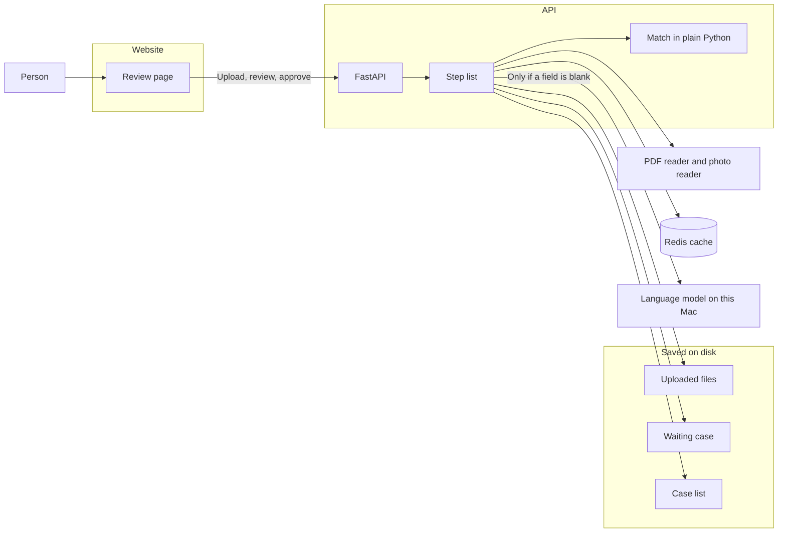
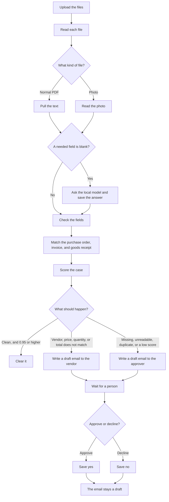

# High-level design

This is a small tool for an accounts payable team. It reads a purchase order, an invoice, and a goods receipt, checks that they agree, and stops for a person before any email is sent.

## Who uses it

An AP clerk uploads the three documents and reviews the result. A clean case can clear on its own. Every other case waits. The clerk can edit the draft, then approve or decline. The email is saved. It is not sent.

## The pieces

The website, the API, and Redis start together in Docker. The language model stays on this Mac. The documents stay on this machine.

| Piece | Job |
| --- | --- |
| Review page | Queue, one case, the score page, and the client note |
| API | Takes the files, runs the steps, and records approve or decline |
| Step list | Read, check, match, score, then clear or draft |
| Match | Compares vendor, currency, quantity, price, and totals in code |
| PDF reader | Pulls the real text from a normal PDF |
| Photo reader | Reads a photo in English and Hindi |
| Language model | Fills a field only when the first read left it blank |
| Redis | Remembers a model answer for seven days |
| Saved files | The uploads, the case list, and the case that is waiting |

The browser talks only to the website. The website calls the API. The API does the work.

## How a case moves

A problem is checked before the score. A wrong vendor, price, quantity, or total is reviewed even when the read looks strong. A missing file, a file we cannot read, or an exact duplicate is rejected even when the score is high.

With no problem, 0.95 or higher clears on its own. From 0.70 up to 0.95, a person reviews it. Below 0.70 it is rejected. Both review and reject write a draft and wait.

## Where things are saved

Uploaded files sit in a folder on disk. The case list is a small JSON file, so the queue can reload. The step list saves its place in a SQLite file while it waits, so the same case can resume after the page is closed. Redis stores only a finished model read. If Redis is down, the run still works.

The score uses a labelled sample pack and an answer key. It checks whether the fields are right, whether real problems are caught, and how long each document took.

## What this design leaves out

There is no login, no approval chain, and no link to an ERP. Vendor identity is the GSTIN printed on the page. Tax covers INR with CGST and SGST. Mail is a draft only. The 0.95 and 0.70 lines are starter values for this sample set.
